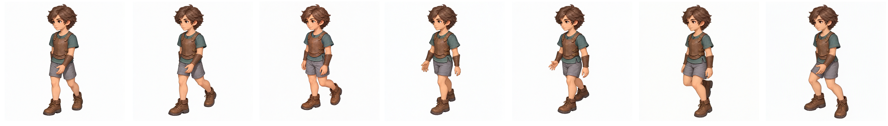

# 기본 걷기 스프라이트 초안

사용자가 모은 걷기 7프레임을 라인아트 복원·팔레트 정렬의 검수 입력으로 보존한다. 정식 최종 에셋 등록이나 보정 결과 승인을 의미하지 않는다. 원본은 수정하지 않았다.

## 자료 구성

현재 재생 기준은 **6 FPS**다. [6 FPS 시트](export-6fps/sheet.png), [6 FPS GIF](export-6fps/review.gif), [현재 메타데이터](export-6fps/metadata.json)를 사용한다. 수정본은 `20261010T103600-102ebdeb`이며 모든 프레임의 개별 유지 시간은 0으로 설정하여 작업 FPS를 따른다. GIF는 형식상 10ms 단위로 저장되므로 현재 내보내기에서는 각 170ms, 7프레임 1190ms로 근사된다. 브라우저의 기준 시간은 1000/6ms다.

아래 `export-20261010T102021-ec59a321`은 변경 전 8 FPS 이력 보관본이며 현재 기준으로 사용하지 않는다.

- `1.png`~`7.png`: 사용자가 모은 초안 프레임. 번호 순서대로 검수한다.
- [내보낸 시트](export-20261010T102021-ec59a321/sheet.png): 스프라이트 편집기 v2의 7열 1행, 384px 셀, 2688×384px 출력 사본.
- [반복 재생 GIF](export-20261010T102021-ec59a321/review.gif): 기존 내보내기 결과이며 이번 정리에서 재생성하지 않았다.
- [출력 메타데이터](export-20261010T102021-ec59a321/metadata.json): 수정본 `20261010T102021-ec59a321`, 프레임 ID·변환·시간 정보를 보존한다.
- 내보내기 폴더의 `frame-001.png`~`frame-007.png`: 출력 프레임 사본. 상위 폴더의 입력 프레임과 구분한다.
- 외형 기준: [light-armor-baseline.png](../../assets/character-baselines/character-default/light-armor-baseline.png). 자세가 아니라 색과 선 표현의 기준이다.

내보내기 출처는 `/home/cbsim/다운로드/sprite-v2-20261010T102021-ec59a321/`이다. 기존 메타데이터의 설정 FPS는 8이며, 내보낸 시간 배열은 각 120ms, 한 주기 840ms이다. 정확한 8 FPS의 125ms와 차이가 있으며 이번 보관에서는 변경하지 않았다. 원본 생성 ID와 프롬프트는 이 내보내기 자료만으로 확정할 수 없다.

## 시트 미리보기

## 보정 목표

1. **라인아트 복원**: 목표 크기 128–512px에서 축소로 약해진 외곽선·내부선을 읽기 쉽게 한다. 포즈·실루엣·프레임 배치를 보존한다.
2. **팔레트 정렬**: 베이스라인을 기준으로 승인한 마스터 팔레트를 전체 방향·동작·프레임에 동일하게 적용한다. 윤곽색과 알파 가장자리를 별도로 검증한다. 자동 디더링은 기본적으로 끈다.

라인 복원 후보 생성 → 마스터 팔레트 강제 매핑 → 알파·외곽선·반복 재생 검수 → 승인 결과만 출력한다. 시트 행·열·여백 재구성은 별도 출력 옵션이며 재생 순서와 시간을 유지한다.

## 채팅에서 확인한 도구 조사

출처 채팅은 `스프라이트 픽셀 정렬 자료 조사`이며 ID는 `01a11593-7245-7211-a0b1-d1c09b07fc06`이다. 초기 답변 원문을 조회하여 아래 후보와 최종 두 기능 합의를 확인했다. 설치·실행 비교 완료 기록은 아니다.

| 구분 | 후보 | 당시 판단 |
| --- | --- | --- |
| 라인 복원 우선 시험 | Anime4K Restore/DTD | 형태 보존 여부를 확인하며 선 복원 후보 생성 |
| 연구 비교 | APISR, Caelum | 라이선스 확인이 필요한 비교 후보 |
| 팔레트 수동 승인 | Aseprite Indexed Color | 공통 팔레트 편집·승인 |
| 팔레트 배치 후보 | proper-pixel-art, libimagequant/pngquant | 공유 팔레트 또는 고정 팔레트 매핑 경로 검증 |
| 후순위 | ComfyUI PixelPipeline | 운영 의존성 검토 필요 |

초기 범용 확대 후보 Real-CUGAN·Real-ESRGAN Anime·SwinIR, 저해상도 후보 PixelArtCNN·Pixel Art Fixer·ComfyUI Pixelization도 조사했으나 최종 목표의 우선 후보와 구분한다. 당시 라이선스 판단은 실제 도입 시 코드·가중치 버전별로 재확인한다.

채팅 원문 식별자: 라인 복원 `01a115a0-4094-7d50-ba4a-5b410ebe8a93`, 목표 크기 `01a115a5-ce18-7fe1-bf60-efd5447dfc1a`, 팔레트 도구 `01a115a7-d08c-7702-a77e-8042a41c5a90`, 최종 합의 `01a115a8-d126-7a12-8363-7d31fda424b0`.

## 검수와 보존 범위

- 얼굴·손·의상 경계 손상과 실루엣 변형을 원본 대비 확인한다.
- 팔레트 밖 색, 윤곽색 흔들림, 흰색·어두운색 배경에서 알파 색 번짐을 검사한다.
- 프레임 반복 재생으로 선·색의 깜빡임을 확인한다. 포즈 변화 자체를 오류로 취급하지 않는다.
- 현재 자료는 보정 전 초안이다. 모델 실험·마스터 팔레트 선정·최종 승인·게임 등록은 아직 수행하지 않았다.
- 출력 메타데이터의 이미지 해시는 편집기 입력 자산 ID이며, 출력 PNG의 파일 해시와 혼동하지 않는다.

내보내기 사본의 원본 일치는 파일별 SHA-256 비교로 확인한다. 향후 실험은 새 `.tmp/test/` 실행 폴더에서 수행하고 이 보관본을 덮어쓰지 않는다.
